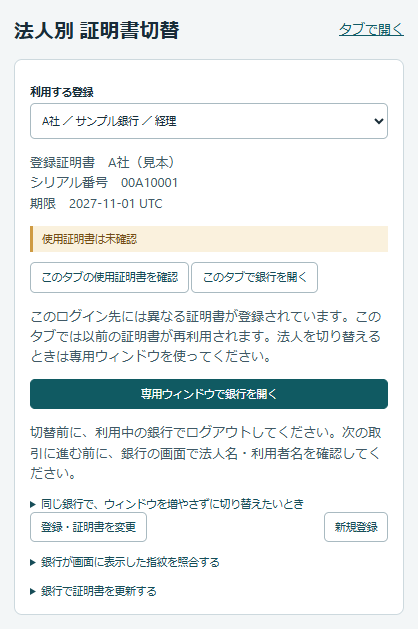

# 法人別 証明書切替

同じ銀行をA社とB社の名義で使うときに、Chrome 全体を閉じずに法人を切り替えられる Windows 用の拡張機能です。法人ごとの専用ウィンドウで銀行を開きます。電子証明書は普段の Chrome で使っているものを利用でき、更新も銀行の通常の手順で行えます。

**[Windows 11 用の公開α版をダウンロード](https://github.com/yoshinsk/Chrome_certificate_changer/releases/download/v0.3.1-alpha.1/ChromeCertificateChanger-Setup.exe)** · [v0.3.1-alpha.1 のリリース情報](https://github.com/yoshinsk/Chrome_certificate_changer/releases/tag/v0.3.1-alpha.1)

対象は Windows 11、Google Chrome、Windows の「現在のユーザー／個人」に登録したソフトウェア証明書です。公開α版は銀行のログインを模した端末内のテストサイトで検証しました。実際の銀行でのログインや取引、ICカード・USBトークンの動作は未検証です。試す前に銀行が案内する対応環境をご確認ください。

## 最初の設定

インストーラーには Chrome 拡張機能と Windows 補助アプリが入っています。GitHub アカウント、管理者権限、コマンド入力は不要です。

1. 上のリンクから `ChromeCertificateChanger-Setup.exe` をダウンロードして開き、「インストール」→「完了」を押します。日本語の設定ガイドが開きます。
2. ガイドの「フォルダーの場所をコピーして Chrome を開く」を押します。
3. Chrome 右上の「デベロッパー モード」をオンにし、左上の「パッケージ化されていない拡張機能を読み込む」を押します。開いた画面の「フォルダー」欄に Ctrl + V で場所を貼り付け、「フォルダーの選択」を押します。
4. Chrome に「法人別 証明書切替」が表示されたら、ガイドの「法人の登録画面を開く」を押します。次回は Chrome 右上の拡張機能メニュー（パズルの形）から開けます。

このα版は Chrome ウェブストアに掲載していません。インストーラーは未署名です。会社の設定で実行や「デベロッパー モード」が制限されている場合は、社内の管理者にご相談ください。[Chrome 公式の追加手順](https://developer.chrome.com/docs/extensions/get-started/tutorial/hello-world#load-unpacked)

## 同じ銀行を別の法人名義で使う

1. 「新規登録」で法人名、銀行・サービス名、銀行の公式ログインURLを入力します。「Windows に登録済みの証明書」からその法人の1枚を選び、名義・シリアル番号・有効期間を確認して保存します。ほかの法人も同じ手順で登録してください。
2. 利用中の銀行でログアウトします。拡張機能の「利用する登録」で次の法人を選び、「専用ウィンドウで銀行を開く」を押します。法人ごとに証明書の選択履歴とログイン状態が分かれるので、普段の Chrome や他法人のウィンドウは開いたままで構いません。
3. Chrome に証明書の選択を求められたら、登録したシリアル番号を確認して選びます。取引に進む前に、銀行の画面に表示された法人名と利用者名も確かめてください。

### 今開いているタブを使う場合

「このタブで銀行を開く」を押すと、表示中のタブに公式ログインページが開きます。**同じ認証先では Chrome が前に選んだ証明書を再利用します。** 法人の登録を選び直しても、そのタブの証明書は切り替わりません。同じ銀行で名義を変えるときは法人ごとの専用ウィンドウを使ってください。[Chromium の証明書選択の仕組み](https://github.com/chromium/chromium/blob/157.0.8103.40/net/ssl/ssl_client_auth_cache.cc#L15-L35)

銀行が Microsoft Edge に対応している場合は、Edge 標準の操作で同じタブの証明書を選び直せます。電子証明書で接続したページのアドレスバー左から「証明書の選択」を開くと、現在の名義を確認できます。「証明書の変更」からの切替を Windows 11 で検証しました。[りそな銀行の画面付き手順](https://www.resonabank.co.jp/hojin/b_direct/security/syoumei_saisentaku.html)・[大分銀行の手順（PDF）](https://www.oitabank.co.jp/business/businessdirect/pdf/densisyoumei.pdf)

### 実際に使った証明書を確認する

「登録証明書」はその法人に使う予定の1枚です。「このタブの使用証明書を確認」は、接続先がページの読み込み時に通知した SHA-256 指紋（証明書を識別する値）を登録と照合します。通知がないページや、登録したログイン先と接続先が異なるページでは「使用証明書は未確認」と表示します。**この通知に対応する実際の銀行は確認できていません。**

銀行の画面に「使用したクライアント証明書」の SHA-256 指紋が表示される場合は、「銀行が画面に表示した指紋を照合する」に貼り付けて確認できます。

## 証明書を更新する

1. これまでどおり銀行の画面や指定ツールで更新します。「銀行で証明書を更新する」から登録済みの更新窓口も開けます。
2. 拡張機能の「登録・証明書を変更」→「証明書一覧を再読み込み」を押します。シリアル番号と有効期間を確認し、新しい証明書を選んで保存します。
3. その法人の銀行画面でログアウトし、その登録の専用ウィンドウをすべて閉じてから開き直します。

## データの保存先と削除

| 内容 | 保存先 |
| --- | --- |
| 法人名・用途・銀行URL・証明書の識別情報 | 拡張機能を追加した Chrome プロファイルのローカルストレージ |
| 法人ごとの専用ウィンドウのデータ | `%LOCALAPPDATA%\ChromeCertificateChanger\profiles\<登録ID>` |
| 証明書と秘密鍵 | Windows の個人証明書ストアと、発行時に指定された鍵プロバイダー |

補助アプリは証明書ストアを読み取り専用で開きます。秘密鍵の書き出しは不要です。拡張機能は銀行の取引本文や Cookie を読み取らず、使用証明書の照合結果も保存しません。

アプリの更新時は、新版のインストーラーを上書き実行し、Chrome の拡張機能画面で「法人別 証明書切替」の再読み込みボタンを押してください。法人の登録は引き継がれます。

削除する場合は、Chrome の拡張機能画面で「法人別 証明書切替」を削除し、Windows の「設定」→「アプリ」→「インストールされているアプリ」から同名のアプリをアンインストールしてください。拡張機能を削除すると法人の登録は消えます。Windows の証明書と上記の専用ウィンドウのデータは残ります。

## 検証結果・不具合の報告

テスト用サーバーが受け取った証明書は、専用ウィンドウを切り替えた順に A社 → B社 → A社 と一致しました。同じ名義の新旧の証明書もシリアル番号と指紋で識別できます。公開α版の配布ファイルでは、同じタブで指紋が一致する場合、異なる場合、確認できない場合の表示を検証しました。[詳しい検証結果・ビルド方法・試験の再現手順](docs/verification.md)

不具合を報告する際は、Windows と Chrome のバージョン、操作手順、表示されたメッセージをお知らせください。公開の投稿には実際の法人名、口座番号、証明書ファイルなどの機密情報を含めないでください。[GitHub Issues](https://github.com/yoshinsk/Chrome_certificate_changer/issues)

## ライセンス

本プロジェクトのソースコードとドキュメントは MIT ライセンスで公開しています。個人・法人を問わず、商用利用、改変、再配布ができます。コピーや主要な部分には著作権表示とライセンス本文を添えてください。インストーラーには本プロジェクトと NSIS のライセンス文書を同梱しています。[MIT ライセンス全文](LICENSE)・[NSIS のライセンス](https://nsis.sourceforge.io/License)
